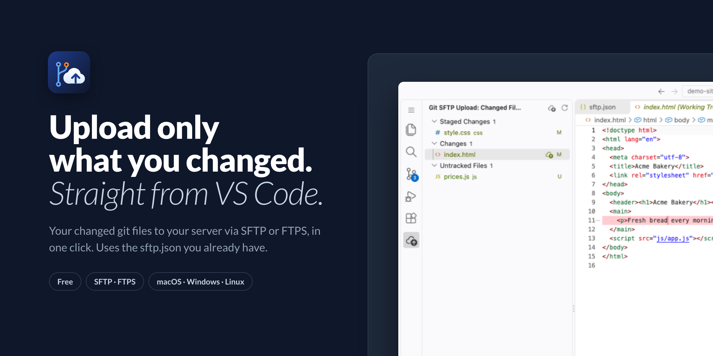
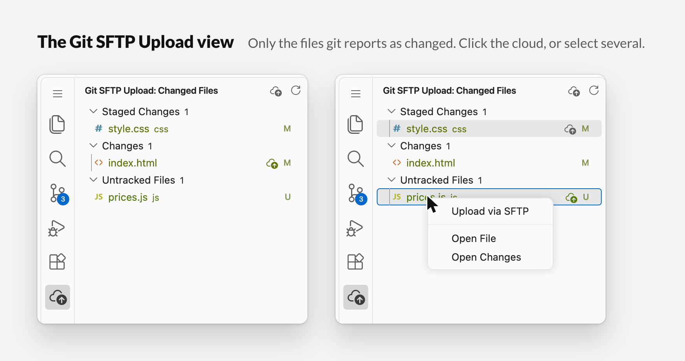
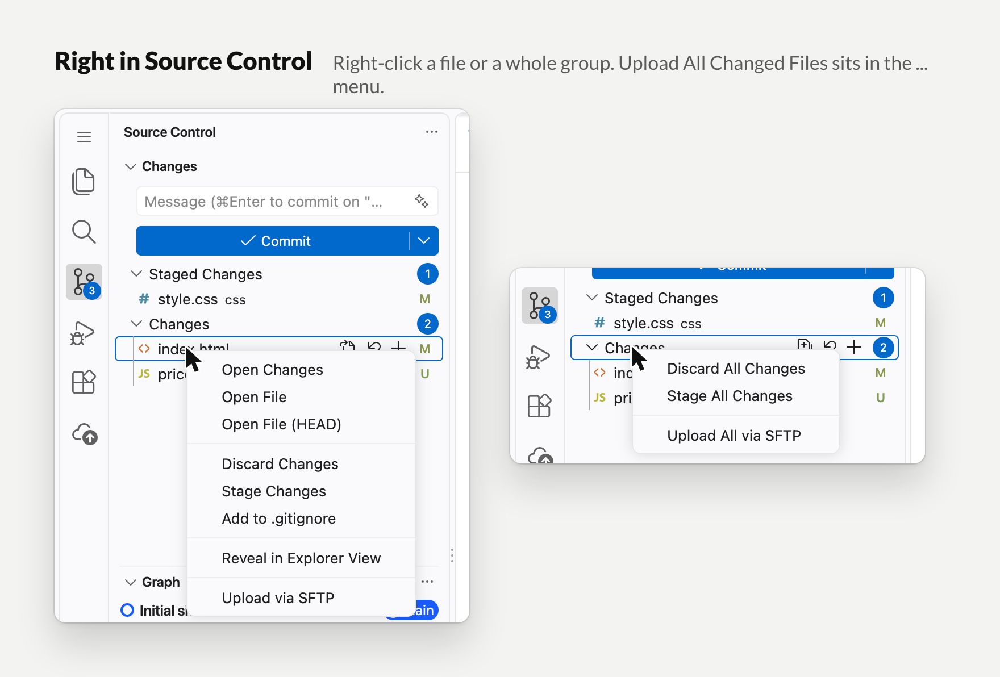
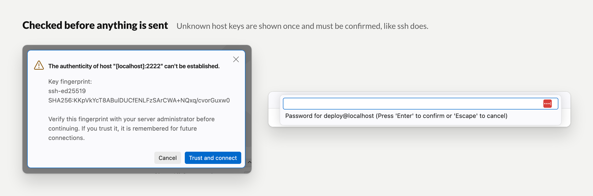
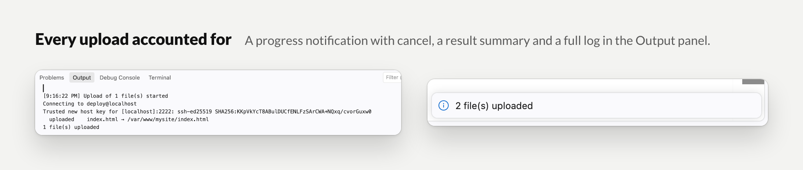

# Git SFTP Upload



**Upload only what you changed.** Git already knows which files you touched. Git SFTP Upload lists exactly those files and puts them on your server via SFTP or FTPS with one click, from the Source Control view or its own sidebar view. No full sync, no guessing, nothing else on the server is touched.

It reads the `.vscode/sftp.json` you already have, so there is nothing to set up.

[](https://marketplace.visualstudio.com/items?itemName=delta-solutions.git-sftp-upload)
[](https://marketplace.visualstudio.com/items?itemName=delta-solutions.git-sftp-upload)
[](https://open-vsx.org/extension/delta-solutions/git-sftp-upload)
[](LICENSE)

**Install:** search for *Git SFTP Upload* in the Extensions view, or open `vscode:extension/delta-solutions.git-sftp-upload`. Also available for Cursor and VSCodium through [Open VSX](https://open-vsx.org/extension/delta-solutions/git-sftp-upload). Free, MIT licensed, macOS, Windows and Linux.

## Why

You fix a bug in two files and a stylesheet. The whole project does not need to go to the server, just those three files. Until now that meant hunting them down in the Explorer one by one, or running a full sync and hoping nothing unexpected went along.

Git SFTP Upload turns your git status into an upload list:

- **Only changed files.** Staged, modified and untracked files, grouped like Source Control shows them. Nothing else is ever uploaded.
- **One click, or a selection.** A single file, several files (Cmd/Ctrl-click), a whole group, or everything at once.
- **Where you already work.** In the Source Control view and in the Git SFTP Upload view in the Activity Bar.
- **Your existing config.** Same `.vscode/sftp.json` as the SFTP extension by Natizyskunk, including profiles and multiple servers. Both extensions work side by side.
- **SFTP and FTPS.** Password, private key or SSH agent for SFTP. Explicit or implicit TLS for FTPS.
- **Safe by default.** Host keys are verified like ssh does, symbolic links are never followed, plain FTP and plaintext passwords are flagged.

## A quick tour

### The Git SFTP Upload view

Click the **cloud icon** in the Activity Bar. The view lists only the files git reports as changed, grouped into *Staged Changes*, *Changes* and *Untracked Files*. Hover a file and click its cloud icon, or right-click → **Upload via SFTP**. Multi-selection is supported. The cloud icon on a group header uploads that group; the one in the view header uploads everything.



### Right in Source Control

Right-click a file under *Changes* or *Staged Changes* → **Upload via SFTP**. Right-click a group header → **Upload All via SFTP**. The `...` menu at the top of Source Control has **Upload All Changed Files via SFTP** for staged, unstaged and untracked files in one go.



### Checked before anything is sent

The first time you connect to a server, its SSH host key fingerprint is shown and must be confirmed. It is then remembered in `~/.ssh/known_hosts`. A key that later changes is refused. Prefer `"password": true` in your config and the password is asked when needed instead of being stored in the workspace.



### Every upload accounted for

A progress notification with cancel, a result summary when it is done, and a full log in the Output panel under *Git SFTP Upload*: which file went where, and what was skipped.



## How it works

1. Install the extension. A cloud icon appears in the Activity Bar.
2. Make sure your project has a `.vscode/sftp.json` (see below). If you use the SFTP extension by Natizyskunk, you already have one.
3. Change some files. Click the cloud icon next to a file, a group, or in the view header. Done.

A full user guide with screenshots (PDF) is available from Delta Solutions: https://www.deltasolutions.be/delta-tools-center/downloads/git-sftp-upload/Git-SFTP-Upload-User-Guide-0.1.0.pdf

## Configuration

The extension reads the same `.vscode/sftp.json` as the SFTP extension by Natizyskunk, so there is nothing extra to set up. A minimal config:

```json
{
  "name": "My site (production)",
  "host": "example.com",
  "protocol": "sftp",
  "username": "deploy",
  "password": true,
  "remotePath": "/var/www/mysite"
}
```

Supported: `host`, `port`, `username`, `password`, `privateKeyPath`, `passphrase`, `agent`, `remotePath`, `context`, `connectTimeout`, `profiles` + `defaultProfile`, and an array of configs.

Protocols:

- `"protocol": "sftp"` (default): SFTP over SSH, with password, private key or agent authentication.
- `"protocol": "ftp"`: FTPS with explicit TLS on port 21 by default. `"secure": "implicit"` uses implicit FTPS on port 990. `"secureOptions"` is passed to Node's TLS connection (for example `{ "rejectUnauthorized": false }` for a self-signed certificate, which is warned about). Unencrypted FTP is only used with an explicit `"secure": false`.

If there is no `defaultProfile`, the extension asks once per upload which profile you want to use.

Settings:

- `gitSftpUpload.configFile`: alternative path to the config (default `.vscode/sftp.json`).
- `gitSftpUpload.deleteRemoteOnDelete`: also delete locally deleted files on the server (off by default; they are skipped instead).

## Security

- **Host key verification (SFTP).** The server's SSH host key is checked against `~/.ssh/known_hosts`. Unknown hosts are shown once with their fingerprint and must be confirmed; the key is then remembered. A key that no longer matches is refused. Use **Git SFTP: Forget Trusted Host Keys** if a server key was changed on purpose.
- **Encrypted by default (FTP).** `"protocol": "ftp"` means FTPS with certificate verification. Plain FTP sends the password and every file in plaintext, so it requires `"secure": false` and is flagged in the Output panel.
- **Symbolic links are never followed.** Linked files and links inside uploaded directories are skipped, so a link pointing outside the repository cannot leak its target.
- **Trusted workspaces only.** The extension stays disabled in Restricted Mode, because the workspace itself decides where files are uploaded.
- **Config stays in the workspace.** `gitSftpUpload.configFile` must point inside the workspace folder.
- **Avoid plaintext passwords.** Use `"password": true` to be prompted instead; the Output panel warns when a plaintext password or passphrase is found.

## FAQ

**Does it replace the SFTP extension by Natizyskunk?**
No, it complements it. That extension syncs, downloads, diffs and uploads on save. Git SFTP Upload does one thing: upload the files git says you changed, one at a time or all at once, with a confirmation for unknown servers. Both read the same `sftp.json` and can be installed together.

**Does it upload deleted files?**
Locally deleted files are skipped by default. Turn on `gitSftpUpload.deleteRemoteOnDelete` to delete them on the server too.

**Which files count as changed?**
Whatever git shows in Source Control: staged, modified and untracked files. Ignored files never appear.

**Does it work with Cursor or VSCodium?**
Yes, install it from [Open VSX](https://open-vsx.org/extension/delta-solutions/git-sftp-upload).

## Publisher

[Delta Solutions](https://www.deltasolutions.be/). Source on [GitHub](https://github.com/dietercoopman/git-sftp-upload); issues and ideas are welcome there.
