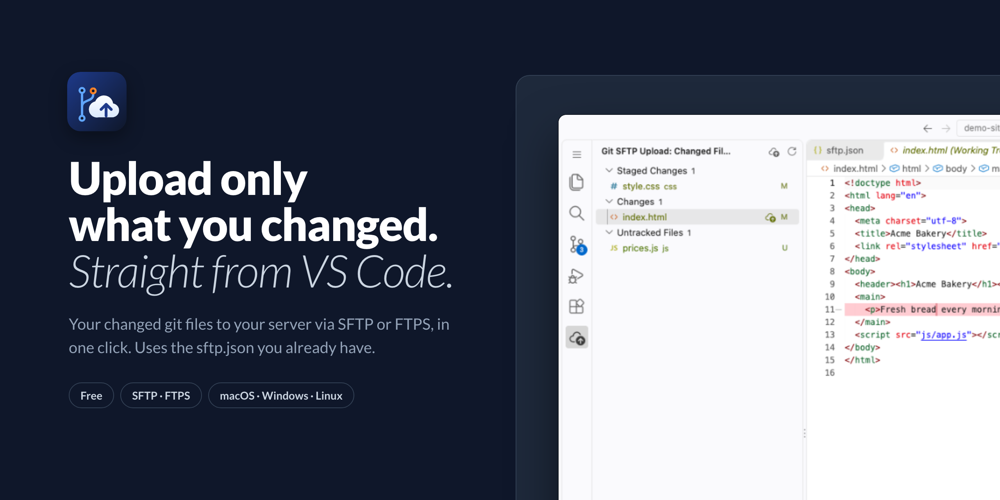
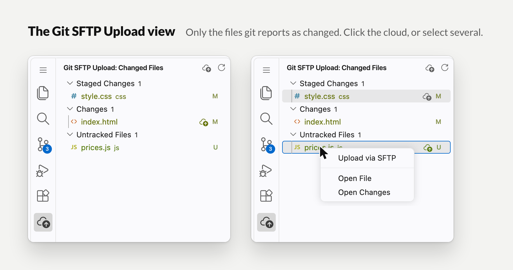
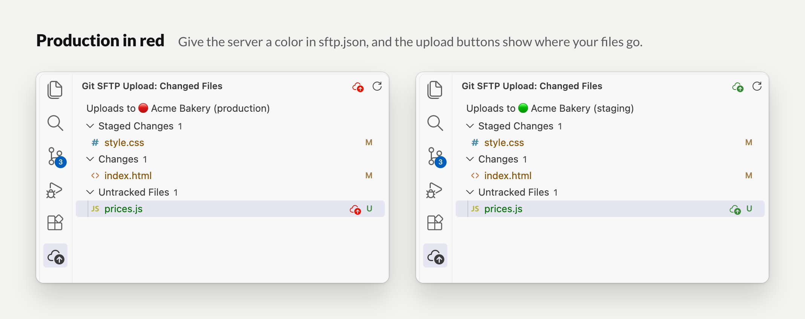
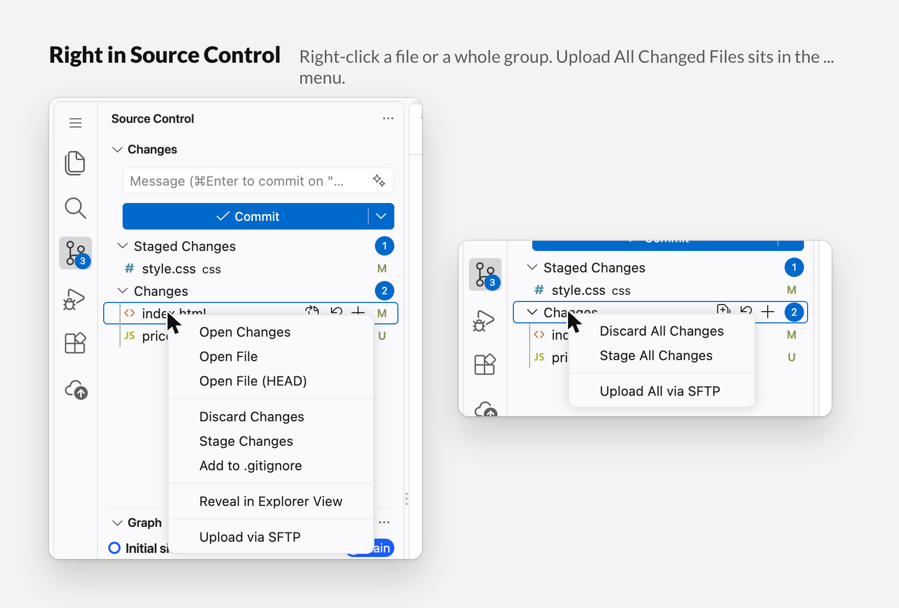
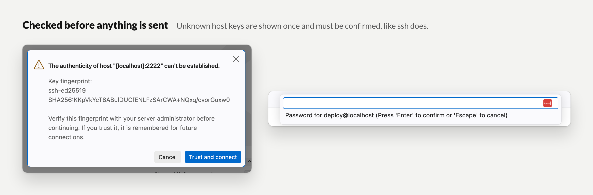
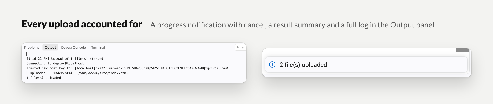

# Git SFTP Upload

[](https://marketplace.visualstudio.com/items?itemName=delta-solutions.git-sftp-upload)
[](https://marketplace.visualstudio.com/items?itemName=delta-solutions.git-sftp-upload)
[](https://marketplace.visualstudio.com/items?itemName=delta-solutions.git-sftp-upload&ssr=false#review-details)
[](https://open-vsx.org/extension/delta-solutions/git-sftp-upload)
[](LICENSE)



**Upload only what you changed.** Git already knows which files you touched. Git SFTP Upload lists exactly those files and puts them on your server via SFTP or FTPS in one click, from Source Control or its own sidebar view. No full sync, no hunting through folders, nothing else on the server is touched.

It reads the `.vscode/sftp.json` you already have, so there is nothing to set up.

**[Install from the VS Code Marketplace](https://marketplace.visualstudio.com/items?itemName=delta-solutions.git-sftp-upload)** · **[Open VSX for Cursor, VSCodium and Windsurf](https://open-vsx.org/extension/delta-solutions/git-sftp-upload)** · Free, MIT licensed, macOS, Windows and Linux.

## Why

You fix a bug in two PHP files and a stylesheet. The whole project does not need to go to the server, just those three files. Until now that meant finding them in the Explorer one by one, or running a full sync and hoping nothing unexpected went along.

Git SFTP Upload turns your git status into an upload list:

- **Only changed files.** Staged, modified and untracked files, grouped the way Source Control shows them. Nothing else is ever uploaded.
- **One click, or a selection.** A single file, several files (Cmd/Ctrl-click), a whole group, or everything at once.
- **Where you already work.** In the Source Control view and in the Git SFTP Upload view in the Activity Bar.
- **Your existing config.** Same `.vscode/sftp.json` as the SFTP extension by Natizyskunk, including profiles and multiple servers. Both extensions work side by side.
- **SFTP and FTPS.** Password, private key or SSH agent for SFTP. Explicit or implicit TLS for FTPS.
- **Safe by default.** Host keys are verified like ssh does, server permissions are kept, symbolic links are never followed, plain FTP and plaintext passwords are flagged.

### Made for projects without a deploy pipeline

Not every site has CI/CD. A WordPress theme on shared hosting, a Laravel or PHP app on a VPS, a static site, a staging server for a client: you edit locally, commit to git, and copy the changes over SFTP. Git SFTP Upload makes that last step one click and takes the guesswork out of it.

| | Upload by hand | Full sync | **Git SFTP Upload** |
|---|:---:|:---:|:---:|
| Knows which files changed | No, you remember | Compares everything | **Yes, from git** |
| Touches only your changes | Yes, if you don't forget one | No | **Yes** |
| Time for a three-file fix | Minutes | Depends on project size | **One click** |
| Host key check and summary of what went where | No | Varies | **Yes** |

## Get started in 30 seconds

1. **Install** the extension. A cloud icon appears in the Activity Bar.
2. **Point it at your server** with a `.vscode/sftp.json` (see [Configuration](#configuration)). Already using the SFTP extension by Natizyskunk? Then you have one, skip this step.
3. **Change some files** and click the cloud icon next to a file, a group, or in the view header. Done.

A full user guide with screenshots is available as a PDF: [Git SFTP Upload User Guide](https://www.deltasolutions.be/delta-tools-center/downloads/git-sftp-upload/Git-SFTP-Upload-User-Guide.pdf).

## A quick tour

### The Git SFTP Upload view

Click the **cloud icon** in the Activity Bar. The view lists only the files git reports as changed, grouped into *Staged Changes*, *Changes* and *Untracked Files*. Hover a file and click its cloud icon, or right-click → **Upload via SFTP**. Multi-selection is supported. The cloud icon on a group header uploads that group; the one in the view header uploads everything.



### Production in red

Give a server a color in `sftp.json`, for example `"color": "red"` on the production profile. The upload buttons in the view take that color, and the view names the server your files go to, so a red button means: this goes live. The target is the config itself or its `defaultProfile`; when you choose a profile at upload time, the buttons stay neutral. [SFTP Remote Editor](https://marketplace.visualstudio.com/items?itemName=delta-solutions.sftp-remote-editor) sets the same color with **Set Color...**.



### Right in Source Control

Right-click a file under *Changes* or *Staged Changes* → **Upload via SFTP**. Right-click a group header → **Upload All via SFTP**. The `...` menu at the top of Source Control has **Upload All Changed Files via SFTP** for staged, unstaged and untracked files in one go.



### Checked before anything is sent

The first time you connect to a server, its SSH host key fingerprint is shown and must be confirmed. It is then remembered in `~/.ssh/known_hosts`. A key that later changes is refused. Prefer `"password": true` in your config and the password is asked when needed instead of being stored in the workspace.



### Every upload accounted for

A progress notification with cancel, a result summary when it is done, and a full log in the Output panel under *Git SFTP Upload*: which file went where, and what was skipped.



## Configuration

The extension reads the same `.vscode/sftp.json` as the SFTP extension by Natizyskunk, so there is nothing extra to set up. A minimal config:

```json
{
  "name": "My site (production)",
  "host": "example.com",
  "protocol": "sftp",
  "username": "deploy",
  "password": true,
  "remotePath": "/var/www/mysite"
}
```

Supported: `host`, `port`, `username`, `password`, `privateKeyPath`, `passphrase`, `agent`, `remotePath`, `context`, `connectTimeout`, `ignore`, `profiles` + `defaultProfile`, and an array of configs.

`ignore` lists paths that are never uploaded, in gitignore syntax relative to the `context`, for example `["/.env", "/wp-content/cache/", "*.log"]`. Changed files on that list are skipped, also inside an uploaded folder, and are never deleted on the server. [SFTP Folder Upload](https://marketplace.visualstudio.com/items?itemName=delta-solutions.sftp-folder-upload) adds **Never Upload** to the Explorer to fill this list with a right-click.

`color` (`red`, `orange`, `yellow`, `green`, `blue` or `purple`) colors the upload buttons in the Changed Files view after the server they upload to, so uploading to a red production server means pressing a red button. The target is the config itself, or its `defaultProfile`; when a profile is chosen at upload time, the buttons stay neutral, and with several servers the most urgent color is shown. [SFTP Remote Editor](https://marketplace.visualstudio.com/items?itemName=delta-solutions.sftp-remote-editor) sets the same `color` with **Set Color...** and shows it on the server's tabs and in the status bar.

Protocols:

- `"protocol": "sftp"` (default): SFTP over SSH, with password, private key or agent authentication.
- `"protocol": "ftp"`: FTPS with explicit TLS on port 21 by default. `"secure": "implicit"` uses implicit FTPS on port 990. `"secureOptions"` is passed to Node's TLS connection (for example `{ "rejectUnauthorized": false }` for a self-signed certificate, which is warned about). Unencrypted FTP is only used with an explicit `"secure": false`.

If there is no `defaultProfile`, the extension asks once per upload which profile you want to use.

Settings:

- `gitSftpUpload.configFile`: alternative path to the config (default `.vscode/sftp.json`).
- `gitSftpUpload.deleteRemoteOnDelete`: also delete locally deleted files on the server (off by default; they are skipped instead).

## Security

- **Host key verification (SFTP).** The server's SSH host key is checked against `~/.ssh/known_hosts`. Unknown hosts are shown once with their fingerprint and must be confirmed; the key is then remembered. A key that no longer matches is refused. Use **Git SFTP: Forget Trusted Host Keys** if a server key was changed on purpose.
- **Encrypted by default (FTP).** `"protocol": "ftp"` means FTPS with certificate verification. Plain FTP sends the password and every file in plaintext, so it requires `"secure": false` and is flagged in the Output panel.
- **Permissions are kept (SFTP).** An uploaded file keeps the owner and permissions it already had on the server; a new file gets the server's default permissions. Versions before 0.2.5 set every uploaded file to 0666; to find such files on a Linux server, run `find /var/www/mysite -type f -perm -o+w` and fix them with `chmod 644`.
- **Never upload what is on the `ignore` list.** Files such as `.env` listed in sftp.json's `ignore` are skipped, even when they show up as changed in git.
- **Symbolic links are never followed.** Linked files and links inside uploaded directories are skipped, so a link pointing outside the repository cannot leak its target.
- **Trusted workspaces only.** The extension stays disabled in Restricted Mode, because the workspace itself decides where files are uploaded.
- **Config stays in the workspace.** `gitSftpUpload.configFile` must point inside the workspace folder.
- **Avoid plaintext passwords.** Use `"password": true` to be prompted instead; the Output panel warns when a plaintext password or passphrase is found.

Found a security issue? Please report it privately, see [SECURITY.md](SECURITY.md).

## FAQ

**Does it replace the SFTP extension by Natizyskunk?**
No, it complements it. That extension syncs, downloads, diffs and uploads on save. Git SFTP Upload does one thing: upload the files git says you changed, one at a time or all at once, with a confirmation for unknown servers. Both read the same `sftp.json` and can be installed together.

**Do I need to commit before uploading?**
No. Modified and untracked files can be uploaded straight away, staged or not. Git is only used to know which files changed.

**Does it upload deleted files?**
Locally deleted files are skipped by default. Turn on `gitSftpUpload.deleteRemoteOnDelete` to delete them on the server too.

**Which files count as changed?**
Whatever git shows in Source Control: staged, modified and untracked files. Ignored files never appear.

**Can I upload to more than one server?**
Yes. Use `profiles` (for example staging and production) or an array of configs in `sftp.json`. Without a `defaultProfile` you choose the profile at upload time.

**Does it work with Cursor, VSCodium or Windsurf?**
Yes, install it from [Open VSX](https://open-vsx.org/extension/delta-solutions/git-sftp-upload).

## Like it?

- **Rate it** on the [Marketplace](https://marketplace.visualstudio.com/items?itemName=delta-solutions.git-sftp-upload&ssr=false#review-details). A short review helps other developers find it.
- **Star it** on [GitHub](https://github.com/dietercoopman/git-sftp-upload).
- **Ideas or bugs?** [Open an issue](https://github.com/dietercoopman/git-sftp-upload/issues/new/choose).

## Publisher

Made by [Delta Solutions](https://www.deltasolutions.be/) in Belgium. More free tools in the [Delta Tools Center](https://www.deltasolutions.be/delta-tools-center/).
